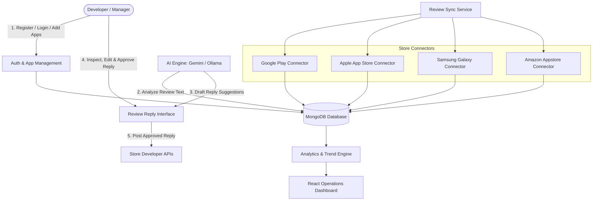

# 📋 Project Proposal: AI-Powered Multi-App Store Review Analysis and Customer Feedback Management System

**Student Name:** Don Carlos John  
**Registration No:** C025-01-0685/2023  
**Institution:** Dedan Kimathi University of Technology  
**School:** School of Computer Science and Information Technology  
**Department:** Information Technology Department  

---

## 1. Executive Summary & Abstract

App developers, product managers, and businesses publish applications across multiple app stores—including **Google Play Store**, **Apple App Store**, **Amazon Appstore**, and **Samsung Galaxy Store**. User reviews are a vital source of feedback, but as review volume scales across platforms, manual tracking and responding become fragmented, slow, and overwhelming.

The **AI-Powered Multi-App Store Review Analysis and Customer Feedback Management System** solves this by:
1. Centralizing review collection from multiple app store platforms into a unified database.
2. Utilizing Artificial Intelligence (LLM/NLP) for automated sentiment analysis, category classification (*Bugs*, *UI/UX*, *Feature Requests*, *Performance*), topic clustering, and review summaries.
3. Enabling secure **User Accounts & Developer App Management** where developers log in, register, add their apps, and link store credentials.
4. Providing **AI-Assisted Review Replies** with a mandatory **Human-in-the-Loop Approval Process** before posting responses back to official store APIs.
5. Offering an interactive dashboard with time-series trend tracking, download metrics, sentiment alerts, and CSV/Excel report exports.

---

## 2. Project Objectives

### 2.1 Main Objective
To design and develop an AI-powered multi-app store review analysis and customer feedback management system that automatically collects, analyzes, tracks, and reports on application user reviews across Google Play, Apple App Store, Amazon Appstore, and Samsung Galaxy Store to support developers, product managers, and businesses in making data-driven decisions.

### 2.2 Specific Objectives
1. **User Authentication & App Management Module:** Develop a secure user authentication and authorization module enabling users to register, log in, add, save, and manage their applications and store API connections.
2. **Automated Multi-Store Review Aggregation:** Build connectors to automatically collect and sync customer reviews across all supported storefronts into a centralized database.
3. **AI Sentiment & Issue Classification:** Implement AI/NLP techniques for sentiment scoring (Positive, Negative, Neutral), category classification (*Bugs*, *UI/UX*, *Features*, *Performance*), topic detection, and executive summaries.
4. **Analytics Dashboards & Trend Reports:** Generate real-time interactive charts, rating trends over time, sentiment distribution, and downloadable analytics reports (CSV/Excel).
5. **Human-Approved AI Review Replies:** Provide an AI-assisted reply drafting engine with a mandatory human verification step before sending approved replies to supported app store APIs.
6. **Continuous Monitoring & Automated Alerts:** Implement continuous background tracking with automated alerts triggered by sharp rating drops, negative review spikes, or recurring technical bugs.

---

## 3. System Architecture & Component Design

---

## 4. Database Schema Specification

| Entity | Purpose & Key Fields |
| :--- | :--- |
| **`User`** | Manages user credentials, roles (`Admin`, `Developer`, `Support`), `email`, `passwordHash`. |
| **`StoreConnection`** | Stores developer store credentials, API keys, and OAuth tokens. |
| **`Application`** | User's saved applications linked to their account (`userId`, `appName`, `createdDate`). |
| **`StoreApplication`** | Maps an `Application` to store-specific IDs (Package Name, App Store ID, Content ID). |
| **`Review`** | Stores normalized raw reviews (`reviewId`, `rating`, `authorName`, `text`, `createdAt`, `platform`). |
| **`ReviewAnalysis`** | Holds AI output (`sentiment`, `category`, `summary`, `confidence`, `processedAt`). |
| **`Topic`** | Grouped themes & recurring user complaint clusters across platforms. |
| **`ReplySuggestion`** | AI-generated response drafts with status (`Pending`, `Edited`, `Approved`, `Rejected`). |
| **`ReviewReply`** | Final human-approved reply text, timestamp, approving user ID, and store submission status. |
| **`Alert`** | Automated alerts for rating drops, spike in negative reviews, or critical bug mentions. |

---

## 5. Functional Requirements Summary

* **FR1 (Authentication & Authorization):** Secure user registration, login, JWT token auth, password recovery, and role-based access.
* **FR2 (App & Store Management):** Add, edit, save, and manage developer applications and link store developer accounts.
* **FR3 (Automated Sync):** Scheduled background syncing of reviews from Google Play, Apple, Samsung, and Amazon.
* **FR4-FR6 (AI Analysis):** Sentiment analysis, topic detection, bug/feature tagger, and AI-generated batch summaries.
* **FR7-FR8 (Dashboard & Search):** Interactive dashboard with full-text search, platform filter, star rating filter, date range, and country.
* **FR9-FR11 (AI Reply & Human Approval):** AI-generated reply suggestions, editable UI text box, approval workflow, and store API publishing.
* **FR12 (Monitoring & Alerts):** Automated notifications for negative sentiment spikes, rating dips, and recurring technical glitches.
* **FR13 (Data Export):** One-click export of raw and analyzed review data to CSV and Excel format.
