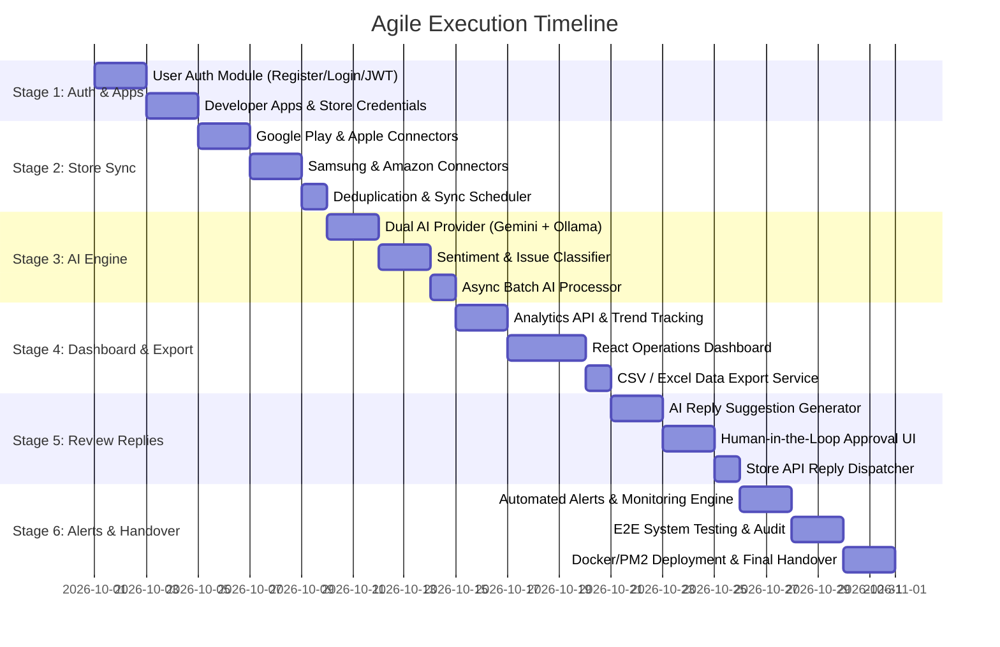

# 📅 Project Execution Timeline & Agile Roadmap

**Project Title:** AI-Powered Multi-App Store Review Analysis and Customer Feedback Management System  
**Author:** Don Carlos John (Dedan Kimathi University of Technology)

---

## 🧭 Milestone Summary

---

## 🎯 Stage-by-Stage Detailed Deliverables

### 🔐 Stage 1: User Authentication & Developer App Management
- [ ] **Task 1.1: User Auth Module (`server/routes/auth.js`)**
  - Registration, Login, Password Hashing (`bcrypt`), JWT Token generation, and role authorization (`Admin`, `Developer`, `Support`).
- [ ] **Task 1.2: Application & Store Credentials Management (`server/routes/apps.js`)**
  - CRUD operations for users to add, save, edit, and delete their apps.
  - Secure storage for store credentials & API keys (`StoreConnection` schema).

---

### 🔄 Stage 2: Multi-Store Automated Review Aggregation
- [ ] **Task 2.1: Multi-Platform Store Connectors (`server/connectors/`)**
  - Refine Google Play, Apple App Store, Samsung Galaxy Store, and Amazon Appstore connectors.
- [ ] **Task 2.2: Sync Scheduler & Deduplication**
  - Implement recurring background cron job (`server/core/sync.service.js`) to automatically fetch new reviews and prevent duplicates.

---

### 🧠 Stage 3: AI Sentiment, Classification & Summarization Engine
- [ ] **Task 3.1: Hybrid AI Service (`server/core/ai.service.js`)**
  - Dual provider support: Gemini API primary with local Ollama fallback.
- [ ] **Task 3.2: Review Schema & AI Classification**
  - Classify sentiment (Positive, Negative, Neutral) and issue category (*Bugs*, *UI/UX*, *Feature Requests*, *Performance*).
  - Background batch AI worker to process reviews asynchronously without API latency.

---

### 📊 Stage 4: Interactive React Dashboard & Data Export Engine
- [ ] **Task 4.1: Analytics REST API & Trend Engine**
  - Time-series rating trends, download metrics, sentiment breakdown, and storefront comparison APIs.
- [ ] **Task 4.2: Modern React + Tailwind Operations Dashboard**
  - Build UI with review table, full-text search, multi-filters (store, rating, sentiment, date), and interactive Recharts graphs.
- [ ] **Task 4.3: CSV / Excel Export Engine**
  - Endpoint (`/api/export`) enabling 1-click download of filtered review data and AI summaries.

---

### 💬 Stage 5: AI-Assisted Review Reply & Human Approval Workflow
- [ ] **Task 5.1: AI Reply Suggestion Engine (`server/core/reply.service.js`)**
  - AI engine generates contextual response drafts based on review sentiment, star rating, and user feedback text.
- [ ] **Task 5.2: Human Approval Interface**
  - Review Reply UI enabling support staff to inspect, edit, approve, or reject AI-drafted replies before submission.
- [ ] **Task 5.3: Store API Reply Dispatcher**
  - Integration with store developer APIs (e.g. Google Play Publisher API) to publish approved replies directly to app stores.

---

### 🔔 Stage 6: Continuous Monitoring, Automated Alerts & Handover
- [ ] **Task 6.1: Automated Alerts Engine**
  - Create alerts when negative sentiment spikes, average rating drops below threshold, or recurring bugs emerge.
- [ ] **Task 6.2: End-to-End System Audit & Testing**
  - Verify complete workflow: User Auth ➡️ Store Sync ➡️ AI Analysis ➡️ Dashboard Analytics ➡️ Human Approval Reply ➡️ Store Posting.
- [ ] **Task 6.3: Production Deployment & Handover**
  - Docker Compose / PM2 configuration, updated setup documentation, and final system handover.
